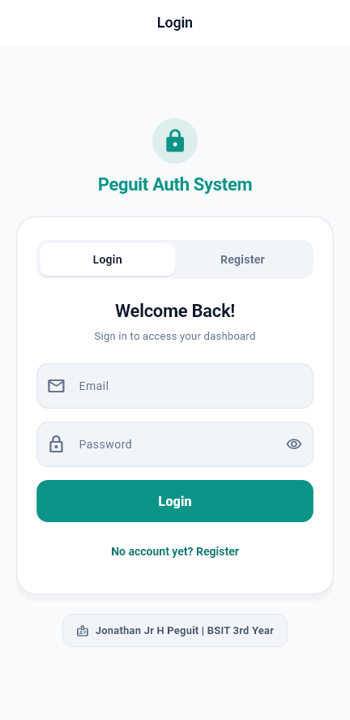
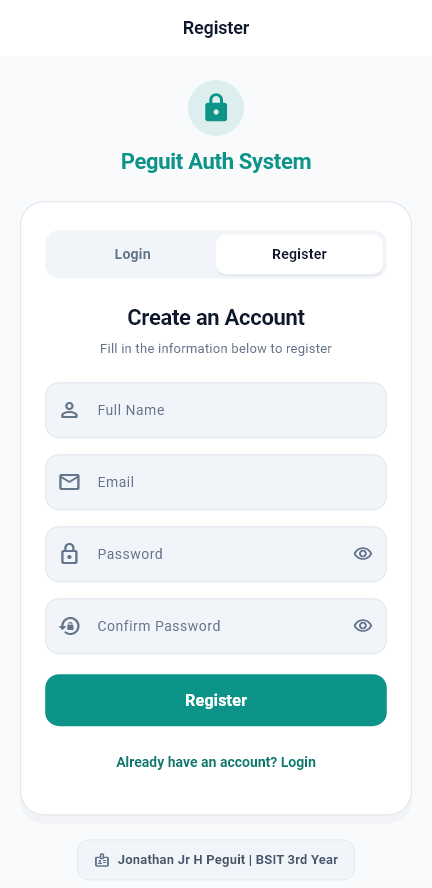
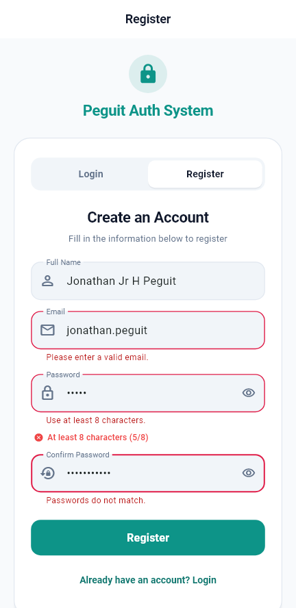
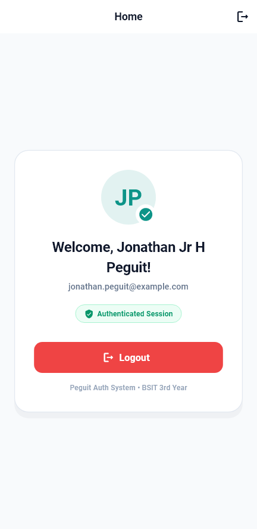

# Peguit Auth System — Lab Activity 3

**Course:** CCE106 — Mobile Programming  
**Student Name:** Jonathan Jr H Peguit  
**Year:** BSIT 3rd Year
**Application Title:** Peguit Auth System  

---

## 📌 Project Overview

This Flutter application implements a complete in-memory authentication workflow featuring form validation, state management, and modern UI/UX design.

### Requirements Implemented
- [x] **Custom Theme Color:** Modern Teal primary color (`#0D9488`) with Slate canvas background (`#F8FAFC`).
- [x] **Application Name Above Form:** Prominent circular lock badge and `Peguit Auth System` branding.
- [x] **Student Name & Year Below Form:** Dedicated `Jonathan Jr H Peguit | BSIT 3rd Year` credential badge.
- [x] **8-Character Minimum Password Validation:** Enforces $\ge 8$ characters with validation message `"Use at least 8 characters."` and live progress counter `At least 8 characters (x/8)`.
- [x] **Interactive Auth Flow:** Functional registration, credential validation, login, welcome screen, and logout.
- [x] **Modular Architecture:** Clean file structure separating core theme/constants, models, screens, and reusable widgets.

---

## 📸 Application Screenshots

| 1. Login Form | 2. Registration Form |
| :---: | :---: |
|  |  |
| *Default login view with app branding and student credentials.* | *Registration form with Full Name, Email, Password, and Confirm Password fields.* |

| 3. Validation Errors | 4. Welcome Dashboard Screen |
| :---: | :---: |
|  |  |
| *Real-time password length indicator, minimum 8 characters error, and email format validation.* | *Authenticated home screen displaying user initial avatar, verified session badge, and logout action.* |

---

## 📝 Answers to Submission Questions

### 1. Why does this activity use a `StatefulWidget`?
> This activity uses a `StatefulWidget` because the interface must dynamically update and maintain mutable state, such as toggling between login and registration views, holding registered user credentials in memory, and transitioning to the welcome screen upon authentication. A `StatelessWidget` is immutable and cannot independently rebuild itself in response to internal state changes.

### 2. What happens when `setState()` is called?
> Calling `setState()` notifies the Flutter framework that the internal state of the widget has changed and flags the widget as dirty. The framework then schedules a rebuild of the widget's subtree by re-executing its `build()` method, updating the UI to match the new state values.

### 3. What is the purpose of a `TextEditingController`?
> A `TextEditingController` manages, reads, and manipulates the text content inside an editable field like `TextFormField`. It provides access to user input for validation and credential checking, while also allowing programmatic clearing of fields during logout or form switching.

### 4. Why does the registered account disappear after restarting the app?
> The registered account disappears because the user information is stored strictly in transient, in-memory variables within the widget state rather than persistent storage. When the application process terminates upon restart, the runtime memory is cleared, requiring persistent solutions like `SharedPreferences` or a database to retain accounts.

---

## 📁 File Structure

```text
lib/
├── main.dart                                  # Application entrypoint & MaterialApp configuration
└── src/
    ├── core/
    │   ├── constants/
    │   │   └── app_constants.dart             # App title, student info, and validation constants
    │   └── theme/
    │       └── app_theme.dart                 # Color palette, InputDecoration, and button styles
    ├── models/
    │   └── user_account.dart                  # UserAccount entity model
    ├── screens/
    │   ├── auth_screen.dart                   # Login & registration forms, controllers, & validation
    │   └── home_screen.dart                   # Authenticated welcome dashboard & logout action
    └── widgets/
        ├── auth_header.dart                   # Circular lock icon badge & title
        ├── password_requirement_indicator.dart# Live password character requirement indicator
        ├── segmented_auth_toggle.dart         # Pill tab toggle between Login and Register
        └── student_footer.dart                # Student name and section badge footer
```

---

## 🚀 Running the Project

```bash
# Run the application
flutter run

# Run unit, widget, and screenshot tests
flutter test

# Run static analysis
flutter analyze
```
